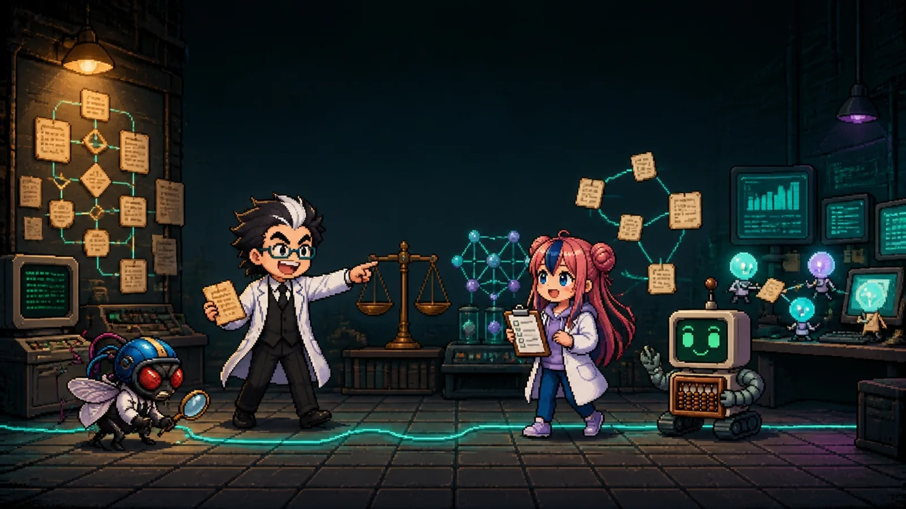

**[한국어](#ko) · [English](#en) · [中文](#zh) · [日本語](#ja) · [Oʻzbekcha](#uz) · [Русский](#ru) · [Tiếng Việt](#vi)**

---

# 플로우 차트의 rule base에서 일하는 AI까지

해설 시리즈 2편 15장. 글 · 안상선 ((주)M-Robo 대표)

- **1편** 플로우 차트의 rule base가 LLM 추론 모델이 되기까지 (1-1 ~ 1-9)
- **2편** LLM 추론 모델이 일하는 AI가 되기까지 (2-1 ~ 2-6)

첫 화면은 `index.html`입니다. 각 장은 그림·스크립트를 모두 품은 단일 HTML 파일이라 서버 없이도 열립니다. 표지 축소본은 `covers/`에 있습니다(목차용).

캐릭터: 박사 · 조수(하루) · 초파리 연구원 · 주판봇 (adminmrobo/fruitfly-lab-expressions)

## 언어

이 시리즈는 한국어 원본과 외국어판 6개로 볼 수 있다.

- 고르는 방법: 화면 최상단 메뉴의 🌐 언어 선택 상자나 오른쪽 아래 🌐 배너에서 고른다. 고른 언어는 브라우저에 기억된다.
- 자동 전환: 한국어 페이지에 처음 들어오면, 브라우저 언어가 지원 언어일 때 그 언어판으로 옮겨 간다. 번역판 주소로 들어오면 그대로 연다.
- 주소 끝에 `?lang=en`처럼 붙이면 그 언어로 바로 연다.
- 언어판 파일은 `이름.언어코드.html` 꼴이다.

<!-- i18n:langtable -->
| 언어 | 파일 이름 | 바로 보기 |
|---|---|---|
| 한국어 | `index.html` | [바로 보기](https://adminmrobo.github.io/rulebase_to_agent/index.html) |
| English | `index.en.html` | [바로 보기](https://adminmrobo.github.io/rulebase_to_agent/index.en.html) |
| 中文 | `index.zh.html` | [바로 보기](https://adminmrobo.github.io/rulebase_to_agent/index.zh.html) |
| 日本語 | `index.ja.html` | [바로 보기](https://adminmrobo.github.io/rulebase_to_agent/index.ja.html) |
| Oʻzbekcha | `index.uz.html` | [바로 보기](https://adminmrobo.github.io/rulebase_to_agent/index.uz.html) |
| Русский | `index.ru.html` | [바로 보기](https://adminmrobo.github.io/rulebase_to_agent/index.ru.html) |
| Tiếng Việt | `index.vi.html` | [바로 보기](https://adminmrobo.github.io/rulebase_to_agent/index.vi.html) |
<!-- /i18n:langtable -->

## 폴더

| 위치 | 내용 |
|---|---|
| `index.html`, `1-1_*.html` ~ `2-6_*.html` | 시리즈 첫 화면과 15개 장 |
| `covers/` | 첫 화면 목차용 표지 축소본 |
| `code/` | 각 장 파이썬 실험 노트 코드와 데이터 (`code/README.md` 참고) |
| `guide/INSTRUCTOR_GUIDE.md` | 강의자용 안내 (15주 과목안·4회 특강안, 장별 목표·토론 질문·과제·오개념, 채점 기준) |
| `guide/COVER_PROMPTS.md` | 표지 생성 프롬프트 17장 (Genspark용): 시리즈 표지·저장소 미리보기·각 장 15장 |
| `kg/{장 번호}/` | 장마다 지식 그래프·참고문헌·페이지 정보 원본(`kg.json`·`refs.json`·`meta.json`)과 점검 보고서·개조 기록. 각 장 페이지 끝의 "지식 색인"과 "꾸러미" 섹션이 이 데이터로 만들어집니다 |
| `kg/KG_00_registry_update.json` | 시리즈 커버리지 지도(KG_00) 등록부에 더할 새 항목 ID |

---

# From the flowchart rule base to AI that works

Commentary series, Part 2, Chapter 15. Written by Ahn Sangsun (CEO, M-Robo Inc.)

- **Part 1** From the Flowchart Rule Base to LLM Reasoning Models (1-1 ~ 1-9)
- **Part 2** From LLM Reasoning Models to Working AI (2-1 ~ 2-6)

The first screen is `index.html`. Each chapter is a single HTML file that contains all of its figures and scripts, so it opens without a server. Thumbnail covers are in `covers/` (for the table of contents).

Characters: Doctor · Assistant (Haru) · Fruit Fly Researcher · AbaBot (adminmrobo/fruitfly-lab-expressions)

## Languages

This series is available in the Korean original and six foreign-language editions.

- How to choose: pick from the 🌐 language selector in the top menu, or from the 🌐 banner at the bottom right. Your choice is remembered in the browser.
- Auto-switch: when you first open a Korean page and your browser language is a supported language, it switches to that language's edition. If you open a translated address, it opens as is.
- Add `?lang=en` (or another language code) to the end of the address to open it directly in that language.
- Language files are named `name.languagecode.html`.

<!-- i18n:langtable -->
| Languages | File name | Open |
|---|---|---|
| 한국어 | `index.html` | [Open](https://adminmrobo.github.io/rulebase_to_agent/index.html) |
| English | `index.en.html` | [Open](https://adminmrobo.github.io/rulebase_to_agent/index.en.html) |
| 中文 | `index.zh.html` | [Open](https://adminmrobo.github.io/rulebase_to_agent/index.zh.html) |
| 日本語 | `index.ja.html` | [Open](https://adminmrobo.github.io/rulebase_to_agent/index.ja.html) |
| Oʻzbekcha | `index.uz.html` | [Open](https://adminmrobo.github.io/rulebase_to_agent/index.uz.html) |
| Русский | `index.ru.html` | [Open](https://adminmrobo.github.io/rulebase_to_agent/index.ru.html) |
| Tiếng Việt | `index.vi.html` | [Open](https://adminmrobo.github.io/rulebase_to_agent/index.vi.html) |
<!-- /i18n:langtable -->

## Folder

| Location | Content |
|---|---|
| `index.html`, `1-1_*.html` ~ `2-6_*.html` | Series front page and 15 chapters |
| `covers/` | Thumbnail cover for the table of contents on the front page |
| `code/` | Python lab notes for each chapter, with code and data (see `code/README.md`) |
| `guide/INSTRUCTOR_GUIDE.md` | Notes for lecturers (15-week course plan and 4-session special lecture plan, per-chapter goals, discussion questions, assignments and misconceptions, grading criteria) |
| `guide/COVER_PROMPTS.md` | 17 cover generation prompts (for Genspark): series cover, repository social preview and the 15 chapters |
| `kg/{chapter number}/` | For each chapter, the source data for the knowledge graph, references, and page information (`kg.json`, `refs.json`, `meta.json`), plus inspection reports and revision records. The "Knowledge index" and "Bundle" sections at the end of each chapter page are built from this data |
| `kg/KG_00_registry_update.json` | New item ID to add to the series coverage map (KG_00) register |

---

# 从流程图的 rule base 到能工作的 AI

系列解说第2部第15章。作者 · Ahn Sangsun（M-Robo 公司 CEO）

- **第1部** 从流程图的 rule base 到 LLM 推理模型 (1-1 ~ 1-9)
- **第2部** 从 LLM 推理模型到能工作的 AI (2-1 ~ 2-6)

首页是 `index.html`。每章都是包含图示与脚本的单一 HTML 文件，无需服务器即可打开。封面缩略图位于 `covers/` 中（用于目录）。

角色：博士 · 助手（Haru） · 果蝇研究员 · 算盘宝 (adminmrobo/fruitfly-lab-expressions)

## 语言

本系列有韩语原版和 6 个外语版本可供阅读。

- 选择方法：在页面最上方菜单的 🌐 语言选择框，或右下角的 🌐 横幅中选择。所选语言会记在浏览器中。
- 自动切换：首次进入韩语页面时，若浏览器语言是受支持的语言，就会切换到对应语言版本。若直接通过翻译版地址进入，则原样打开。
- 在地址末尾加上 `?lang=en` 之类，即可直接以该语言打开。
- 语言版文件名为 `名称.语言代码.html` 格式。

<!-- i18n:langtable -->
| 语言 | 文件名 | 直接查看 |
|---|---|---|
| 한국어 | `index.html` | [直接查看](https://adminmrobo.github.io/rulebase_to_agent/index.html) |
| English | `index.en.html` | [直接查看](https://adminmrobo.github.io/rulebase_to_agent/index.en.html) |
| 中文 | `index.zh.html` | [直接查看](https://adminmrobo.github.io/rulebase_to_agent/index.zh.html) |
| 日本語 | `index.ja.html` | [直接查看](https://adminmrobo.github.io/rulebase_to_agent/index.ja.html) |
| Oʻzbekcha | `index.uz.html` | [直接查看](https://adminmrobo.github.io/rulebase_to_agent/index.uz.html) |
| Русский | `index.ru.html` | [直接查看](https://adminmrobo.github.io/rulebase_to_agent/index.ru.html) |
| Tiếng Việt | `index.vi.html` | [直接查看](https://adminmrobo.github.io/rulebase_to_agent/index.vi.html) |
<!-- /i18n:langtable -->

## 文件夹

| 位置 | 内容 |
|---|---|
| `index.html`, `1-1_*.html` ~ `2-6_*.html` | 系列首页与 15 个章节 |
| `covers/` | 首页目录用的封面缩略图 |
| `code/` | 各章 Python 实验笔记的代码与数据（参见 `code/README.md`） |
| `guide/INSTRUCTOR_GUIDE.md` | 讲师用指南（15 周课程方案 · 4 次特别讲座方案，各章目标、讨论问题、作业、常见误区、评分标准） |
| `guide/COVER_PROMPTS.md` | 17 张封面生成提示词（用于 Genspark）：系列封面、仓库预览图与 15 章 |
| `kg/{章节编号}/` | 每章的知识图谱、参考文献、页面信息原始数据（`kg.json`·`refs.json`·`meta.json`），以及检查报告和改写记录。每章页面末尾的“知识索引”和“数据包”部分即由这些数据生成 |
| `kg/KG_00_registry_update.json` | 加入系列覆盖地图（KG_00）登记表的新项目 ID |

---

# フローチャートのrule baseから仕事をするAIまで

解説シリーズ 2編 15章。 著 · Ahn Sangsun（株式会社M-Robo 代表）

- **1編** フローチャートのrule baseがLLM推論モデルになるまで (1-1 ~ 1-9)
- **2編** LLM推論モデルが仕事をするAIになるまで (2-1 ~ 2-6)

最初の画面は `index.html` です。各章は図やスクリプトをすべて含む単一のHTMLファイルなので、サーバーがなくても開けます。表紙の縮小版は `covers/` にあります（目次用）。

キャラクター: 博士 · 助手（ハル） · ショウジョウバエ研究員 · アバボット (adminmrobo/fruitfly-lab-expressions)

## 言語

このシリーズは韓国語の原本と、外国語版6種で読むことができます。

- 選び方: 画面最上部のメニューにある🌐言語選択ボックス、または右下の🌐バナーから選びます。選んだ言語はブラウザに記憶されます。
- 自動切替: 韓国語ページに初めて入ると、ブラウザの言語が対応言語であればその言語版に移ります。翻訳版のアドレスで入った場合は、そのまま開きます。
- アドレスの末尾に `?lang=en` のように付けると、その言語ですぐ開きます。
- 言語版ファイルは `名前.言語コード.html` の形式です。

<!-- i18n:langtable -->
| 言語 | ファイル名 | すぐ見る |
|---|---|---|
| 한국어 | `index.html` | [すぐ見る](https://adminmrobo.github.io/rulebase_to_agent/index.html) |
| English | `index.en.html` | [すぐ見る](https://adminmrobo.github.io/rulebase_to_agent/index.en.html) |
| 中文 | `index.zh.html` | [すぐ見る](https://adminmrobo.github.io/rulebase_to_agent/index.zh.html) |
| 日本語 | `index.ja.html` | [すぐ見る](https://adminmrobo.github.io/rulebase_to_agent/index.ja.html) |
| Oʻzbekcha | `index.uz.html` | [すぐ見る](https://adminmrobo.github.io/rulebase_to_agent/index.uz.html) |
| Русский | `index.ru.html` | [すぐ見る](https://adminmrobo.github.io/rulebase_to_agent/index.ru.html) |
| Tiếng Việt | `index.vi.html` | [すぐ見る](https://adminmrobo.github.io/rulebase_to_agent/index.vi.html) |
<!-- /i18n:langtable -->

## フォルダ

| 場所 | 内容 |
|---|---|
| `index.html`, `1-1_*.html` ~ `2-6_*.html` | シリーズの最初の画面と15の章 |
| `covers/` | 最初の画面の目次用表紙の縮小版 |
| `code/` | 各章のPython実験ノートのコードとデータ（`code/README.md` を参照） |
| `guide/INSTRUCTOR_GUIDE.md` | 講師向けのご案内（15週の授業案・4回の特別講義案、章ごとの目標・討論の質問・課題・誤概念、採点基準） |
| `guide/COVER_PROMPTS.md` | 表紙17枚の生成プロンプト（Genspark用）：シリーズ表紙・リポジトリのプレビュー画像・各章15枚 |
| `kg/{章番号}/` | 章ごとの知識グラフ・参考文献・ページ情報の原本（`kg.json`・`refs.json`・`meta.json`）と点検報告書・改修記録。各章ページの末尾にある「知識索引」と「パッケージ」のセクションは、このデータから作られます |
| `kg/KG_00_registry_update.json` | シリーズのカバレッジマップ（KG_00）登録簿に追加する新しい項目ID |

---

# Flowchart rule base’dan ishlaydigan AIgacha

Izohli seriya 2-qism, 15-bob. Muallif · Ahn Sangsun (M-Robo kompaniyasi rahbari)

- **1-qism** Flowchart rule base’dan LLM xulosa modeligacha (1-1 ~ 1-9)
- **2-qism** LLM xulosa modelidan ishlaydigan AIgacha (2-1 ~ 2-6)

Birinchi ekran — `index.html`. Har bir bob rasm va skriptlarni oʻz ichiga olgan yagona HTML fayl boʻlgani uchun serversiz ham ochiladi. Muqovaning kichraytirilgan nusxalari `covers/` papkasida (mundarija uchun).

Qahramonlar: Doktor · Yordamchi (Haru) · Meva pashshasi tadqiqotchisi · AbaBot (adminmrobo/fruitfly-lab-expressions)

## Til

Bu seriyani koreyscha asl nusxada va oltita xorijiy tildagi nashrda koʻrish mumkin.

- Tanlash usuli: ekranning eng yuqoridagi menyudagi 🌐 til tanlash oynasidan yoki pastki oʻng burchakdagi 🌐 bannerdan tanlanadi. Tanlangan til brauzerda eslab qolinadi.
- Avtomatik oʻtish: koreyscha sahifaga birinchi marta kirilganda, brauzer tili qoʻllab-quvvatlanadigan til boʻlsa, oʻsha til nashriga oʻtiladi. Tarjima nashrining manzili orqali kirilsa, oʻsha holicha ochiladi.
- Manzil oxiriga `?lang=en` kabi qoʻshilsa, oʻsha tilda darhol ochiladi.
- Til nashri fayli `nom.tilkodi.html` shaklida boʻladi.

<!-- i18n:langtable -->
| Til | Fayl nomi | Darhol koʻrish |
|---|---|---|
| 한국어 | `index.html` | [Darhol koʻrish](https://adminmrobo.github.io/rulebase_to_agent/index.html) |
| English | `index.en.html` | [Darhol koʻrish](https://adminmrobo.github.io/rulebase_to_agent/index.en.html) |
| 中文 | `index.zh.html` | [Darhol koʻrish](https://adminmrobo.github.io/rulebase_to_agent/index.zh.html) |
| 日本語 | `index.ja.html` | [Darhol koʻrish](https://adminmrobo.github.io/rulebase_to_agent/index.ja.html) |
| Oʻzbekcha | `index.uz.html` | [Darhol koʻrish](https://adminmrobo.github.io/rulebase_to_agent/index.uz.html) |
| Русский | `index.ru.html` | [Darhol koʻrish](https://adminmrobo.github.io/rulebase_to_agent/index.ru.html) |
| Tiếng Việt | `index.vi.html` | [Darhol koʻrish](https://adminmrobo.github.io/rulebase_to_agent/index.vi.html) |
<!-- /i18n:langtable -->

## Papka

| Joylashuv | Mazmun |
|---|---|
| `index.html`, `1-1_*.html` ~ `2-6_*.html` | Seriyaning birinchi ekrani va 15 ta bob |
| `covers/` | Birinchi ekran mundarijasi uchun muqovaning kichraytirilgan nusxalari |
| `code/` | Har bir bobning Python tajriba daftari kodi va ma'lumotlari (`code/README.md`ga qarang) |
| `guide/INSTRUCTOR_GUIDE.md` | Ma'ruzachi uchun qoʻllanma (15 haftalik kurs rejasi va 4 martalik maxsus ma'ruza rejasi, bob boʻyicha maqsad, muhokama savollari, topshiriq, notoʻgʻri tushunchalar, baholash mezonlari) |
| `guide/COVER_PROMPTS.md` | 17 ta muqova uchun promptlar (Genspark uchun): turkum muqovasi, repozitoriy koʻrinishi va 15 bob |
| `kg/{bob raqami}/` | Har bir bob uchun bilimlar grafi, adabiyotlar va sahifa ma'lumotlarining asl nusxasi (`kg.json`, `refs.json`, `meta.json`) hamda tekshiruv hisoboti va qayta ishlash yozuvi. Har bir bob sahifasi oxiridagi «Bilimlar indeksi» va «Toʻplam» boʻlimlari shu ma'lumotlardan yasaladi |
| `kg/KG_00_registry_update.json` | Seriya qamrovi xaritasi (KG_00) roʻyxatiga qoʻshiladigan yangi band ID si |

---

# От rule base в блок-схеме до работающего ИИ

Серия разборов, часть 2, глава 15. Автор: Ahn Sangsun (генеральный директор M-Robo)

- **Часть 1** От блок-схемы с rule base до LLM-модели рассуждений (1-1 ~ 1-9)
- **Часть 2** От LLM-модели рассуждений до работающего ИИ (2-1 ~ 2-6)

Первая страница — `index.html`. Каждая глава — один HTML-файл со всеми рисунками и скриптами внутри, поэтому открывается и без сервера. Уменьшенные копии обложек лежат в `covers/` (для оглавления).

Персонажи: Доктор · ассистент (Хару) · Исследователь-дрозофила · АбаБот (adminmrobo/fruitfly-lab-expressions)

## Язык

Эту серию можно читать в корейском оригинале и в 6 иноязычных версиях.

- Как выбрать: в списке 🌐 в верхнем меню экрана или на баннере 🌐 справа внизу. Выбранный язык запоминается в браузере.
- Автопереключение: при первом заходе на корейскую страницу, если язык браузера поддерживается, открывается версия на этом языке. Если вы зашли по адресу переведённой версии, она открывается как есть.
- Если добавить в конец адреса `?lang=en`, страница сразу откроется на этом языке.
- Файлы языковых версий имеют вид `имя.код_языка.html`.

<!-- i18n:langtable -->
| Язык | Имя файла | Открыть |
|---|---|---|
| 한국어 | `index.html` | [Открыть](https://adminmrobo.github.io/rulebase_to_agent/index.html) |
| English | `index.en.html` | [Открыть](https://adminmrobo.github.io/rulebase_to_agent/index.en.html) |
| 中文 | `index.zh.html` | [Открыть](https://adminmrobo.github.io/rulebase_to_agent/index.zh.html) |
| 日本語 | `index.ja.html` | [Открыть](https://adminmrobo.github.io/rulebase_to_agent/index.ja.html) |
| Oʻzbekcha | `index.uz.html` | [Открыть](https://adminmrobo.github.io/rulebase_to_agent/index.uz.html) |
| Русский | `index.ru.html` | [Открыть](https://adminmrobo.github.io/rulebase_to_agent/index.ru.html) |
| Tiếng Việt | `index.vi.html` | [Открыть](https://adminmrobo.github.io/rulebase_to_agent/index.vi.html) |
<!-- /i18n:langtable -->

## Папка

| Расположение | Содержание |
|---|---|
| `index.html`, `1-1_*.html` ~ `2-6_*.html` | Первая страница серии и 15 глав |
| `covers/` | Уменьшенные копии обложек для оглавления |
| `code/` | Код и данные питоновских блокнотов экспериментов к каждой главе (см. `code/README.md`) |
| `guide/INSTRUCTOR_GUIDE.md` | Материалы для преподавателя (программа курса на 15 недель и 4 спецлекций, цели глав, вопросы для обсуждения, задания, типичные заблуждения, критерии оценки) |
| `guide/COVER_PROMPTS.md` | 17 промптов для создания обложек (для Genspark): обложка серии, превью репозитория и 15 глав |
| `kg/{номер главы}/` | Исходные данные по каждой главе: граф знаний, библиография и сведения о странице (`kg.json`·`refs.json`·`meta.json`), отчёты о проверке и журнал доработок. Разделы «Указатель знаний» и «Пакет» в конце каждой главы создаются из этих данных |
| `kg/KG_00_registry_update.json` | ID новой записи для реестра карты охвата серии (KG_00) |

---

# Từ rule base của lưu đồ đến AI biết làm việc

Loạt bài giải thích, Phần 2, Chương 15. Tác giả · Ahn Sangsun (Giám đốc điều hành M-Robo)

- **Phần 1** Từ rule base của lưu đồ đến mô hình suy luận LLM (1-1 ~ 1-9)
- **Phần 2** Từ mô hình suy luận LLM đến AI biết làm việc (2-1 ~ 2-6)

Màn hình đầu tiên là `index.html`. Mỗi chương là một tệp HTML đơn chứa trọn hình và script nên mở được mà không cần máy chủ. Bản thu nhỏ của bìa nằm trong `covers/` (dùng cho mục lục).

Nhân vật: Tiến sĩ · Trợ lý (Haru) · Nhà nghiên cứu Ruồi giấm · AbaBot (adminmrobo/fruitfly-lab-expressions)

## Ngôn ngữ

Loạt bài này có thể xem bằng bản gốc tiếng Hàn và 6 bản ngoại ngữ.

- Cách chọn: chọn ở hộp chọn ngôn ngữ 🌐 trên menu ở đầu màn hình hoặc ở biểu ngữ 🌐 phía dưới bên phải. Ngôn ngữ đã chọn sẽ được trình duyệt ghi nhớ.
- Tự động chuyển: khi vào trang tiếng Hàn lần đầu, nếu ngôn ngữ trình duyệt là ngôn ngữ được hỗ trợ thì sẽ chuyển sang bản ngôn ngữ đó. Nếu vào bằng địa chỉ của bản dịch thì mở đúng bản đó.
- Thêm vào cuối địa chỉ như `?lang=en` thì sẽ mở thẳng bằng ngôn ngữ đó.
- Tệp của bản ngôn ngữ có dạng `tên.mã-ngôn-ngữ.html`.

<!-- i18n:langtable -->
| Ngôn ngữ | Tên tệp | Xem ngay |
|---|---|---|
| 한국어 | `index.html` | [Xem ngay](https://adminmrobo.github.io/rulebase_to_agent/index.html) |
| English | `index.en.html` | [Xem ngay](https://adminmrobo.github.io/rulebase_to_agent/index.en.html) |
| 中文 | `index.zh.html` | [Xem ngay](https://adminmrobo.github.io/rulebase_to_agent/index.zh.html) |
| 日本語 | `index.ja.html` | [Xem ngay](https://adminmrobo.github.io/rulebase_to_agent/index.ja.html) |
| Oʻzbekcha | `index.uz.html` | [Xem ngay](https://adminmrobo.github.io/rulebase_to_agent/index.uz.html) |
| Русский | `index.ru.html` | [Xem ngay](https://adminmrobo.github.io/rulebase_to_agent/index.ru.html) |
| Tiếng Việt | `index.vi.html` | [Xem ngay](https://adminmrobo.github.io/rulebase_to_agent/index.vi.html) |
<!-- /i18n:langtable -->

## Thư mục

| Vị trí | Nội dung |
|---|---|
| `index.html`, `1-1_*.html` ~ `2-6_*.html` | Màn hình đầu tiên của loạt bài và 15 chương |
| `covers/` | Bản thu nhỏ của bìa dùng cho mục lục màn hình đầu |
| `code/` | Mã và dữ liệu của sổ tay thí nghiệm Python cho từng chương (xem `code/README.md`) |
| `guide/INSTRUCTOR_GUIDE.md` | Hướng dẫn cho giảng viên (giáo án môn học 15 tuần và giáo án 4 buổi chuyên đề, mục tiêu từng chương, câu hỏi thảo luận, bài tập, quan niệm sai, tiêu chí chấm điểm) |
| `guide/COVER_PROMPTS.md` | 17 prompt tạo bìa (dùng cho Genspark): bìa bộ bài, ảnh xem trước kho mã và 15 chương |
| `kg/{số chương}/` | Bản gốc của đồ thị tri thức, tài liệu tham khảo và thông tin trang của từng chương (`kg.json`, `refs.json`, `meta.json`) cùng báo cáo kiểm tra và nhật ký chỉnh sửa. Các mục "Chỉ mục tri thức" và "Gói" ở cuối trang mỗi chương được tạo từ dữ liệu này |
| `kg/KG_00_registry_update.json` | ID mục mới cần thêm vào sổ đăng ký bản đồ phạm vi phủ của loạt bài (KG_00) |
